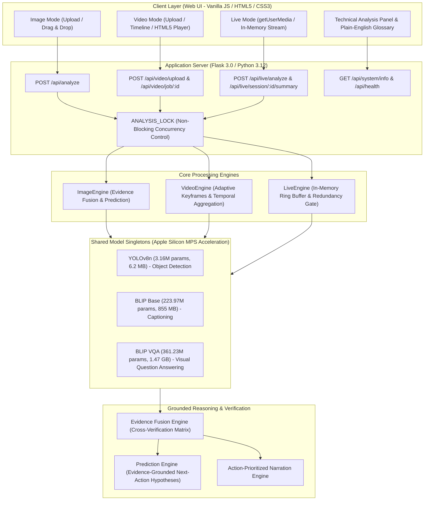
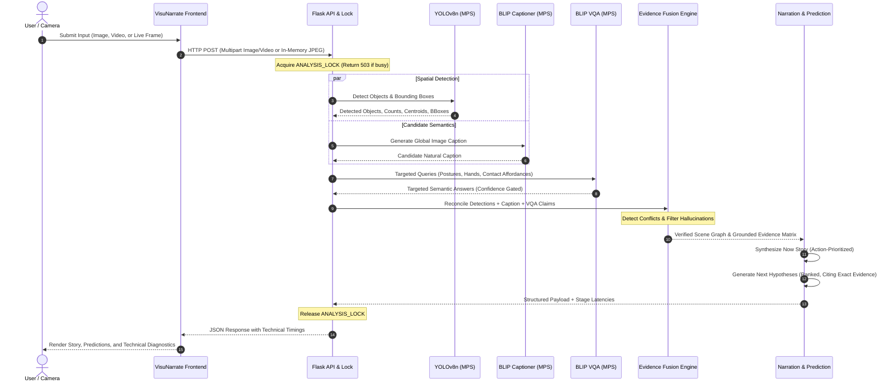

# VisuNarrate - System Architecture & Engineering Specifications

VisuNarrate is an on-device multimodal reasoning system designed for Apple Silicon (macOS). It ingests static imagery, video files, and real-time live camera streams to generate contextual narratives and evidence-grounded future-action predictions.

---

## 1. High-Level System Architecture

All three operational pipelines (**Image Mode**, **Video Mode**, **Live Mode**) execute against shared, persistent model singletons managed behind a non-blocking mutex (`ANALYSIS_LOCK`).

---

## 2. Multimodal Data Flow Pipeline

From raw sensory input to grounded linguistic narration and predictive hypotheses:

---

## 3. Apple Silicon M1 (8 GB Unified Memory) Budget

VisuNarrate is engineered to operate safely within the strict resource envelope of an 8 GB Apple Silicon M1 machine.

| Component | Allocated Footprint | Description |
|---|---|---|
| **macOS & Core Services** | ~3.8 GB – 4.5 GB | Operating system, window server, system daemons. |
| **Model Weights (Unified Memory)** | **~2.33 GB** | Loaded once during warm-up and retained: • BLIP Base: 855.1 MB • BLIP VQA: 1,468.4 MB • YOLOv8n: 6.2 MB |
| **Python Runtime & App State** | ~250 MB – 350 MB | Flask process, NumPy/Torch runtimes, UI serving. |
| **Working Buffer & PyTorch MPS Cache** | ~400 MB – 600 MB | Dynamic tensors during forward passes (cleared post-batch). |
| **Free / Available Headroom** | **~1.0 GB – 1.8 GB** | Safety margin ensuring zero macOS swap thrashing. |

### Memory Management Safeguards
1. **Single-Instance Mutex (`ANALYSIS_LOCK`)**: Enforces that only one inference job executes concurrently. Concurrent requests immediately return HTTP 503 with `"is_busy": True`, preventing simultaneous batch allocation.
2. **In-Memory Ring Buffers**: Live Mode maintains at most 60 historical frame descriptors in RAM; older frames are automatically evicted.
3. **Session Auto-Eviction**: Live sessions inactive for >15 minutes are garbage-collected automatically.

---

## 4. Security, Offline Integrity & Privacy

- **100% Offline Runtime**: The application runs completely disconnected from the Internet.
  - `HF_HUB_OFFLINE=1`
  - `TRANSFORMERS_OFFLINE=1`
  - `YOLO_OFFLINE=1`
  - No CDNs, remote fonts, external telemetry, or analytics scripts.
- **Strict Privacy in Live Mode**: Live camera frames are streamed via WebRTC/Canvas into volatile memory (`cv2.imdecode`) and **never written to the filesystem**. Session state exists only in RAM and can be wiped instantly via the UI Reset button.
- **Deterministic & Verifiable**: No generative LLM API calls, no hidden prompt mutations, and zero simulated/faked metrics.
